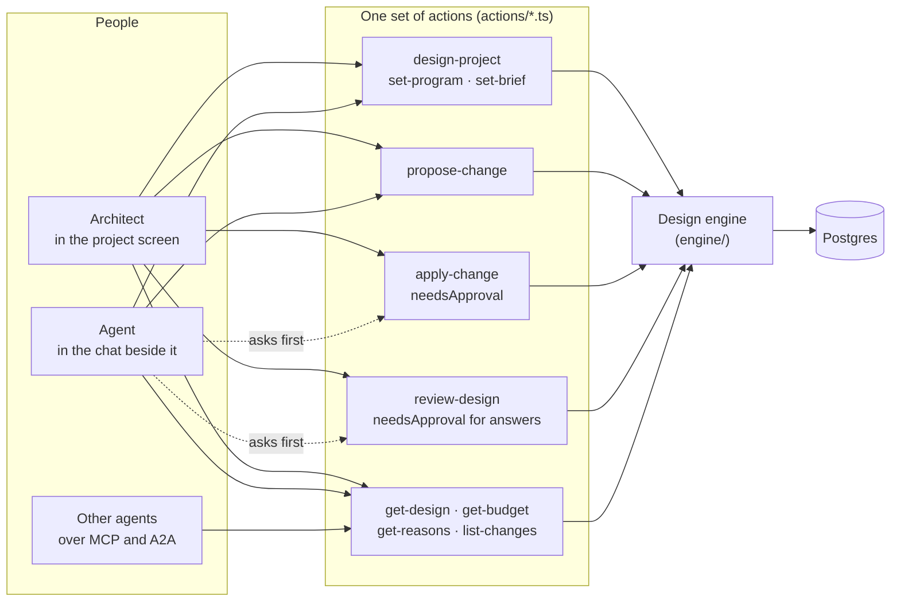
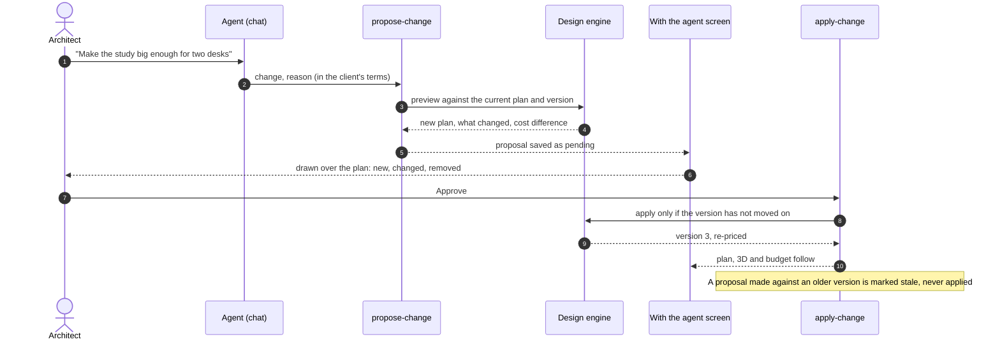
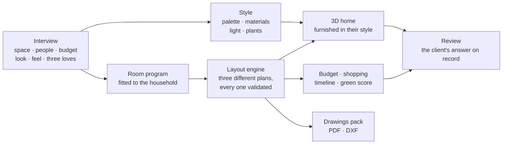
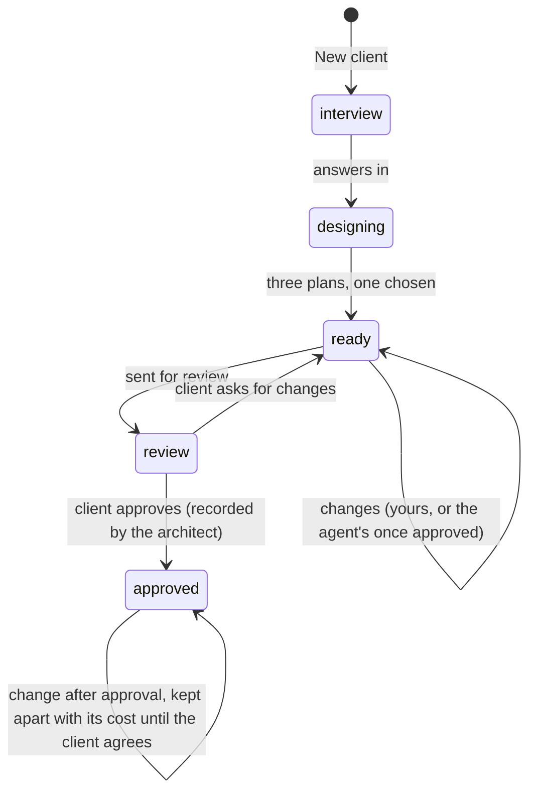
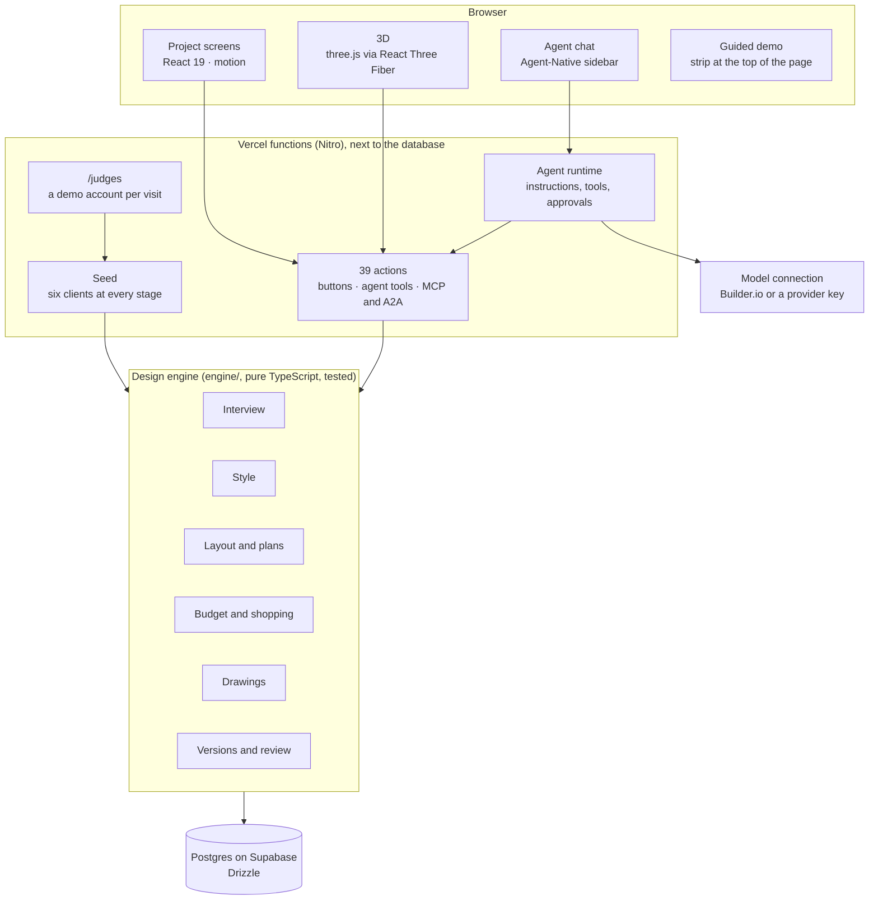
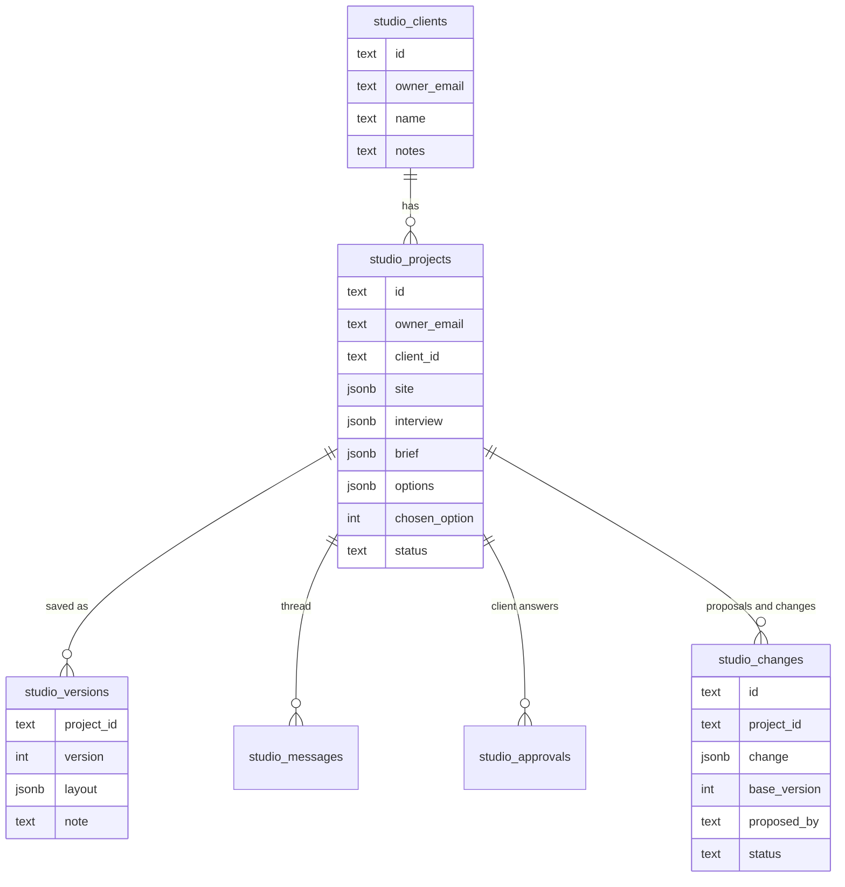

# Arcon Studio

**The architect's studio, with an agent that knows the client's taste. It proposes; the architect approves.**

Sit with your client and run the interview together: who lives there, how they live, the budget, a look, a feel and three things they love. Arcon Studio turns the answers into the client's style, three floor plans with honest trade-offs, a furnished 3D home to walk through, a budget in their currency, a shopping list and a drawings pack. An agent works beside the architect the whole time: ask it in plain words and it proposes the change, drawn over the plan with its cost. Nothing changes until the architect presses Approve.

Live at **[arcon-studio.vercel.app](https://arcon-studio.vercel.app)** · For judges: **[arcon-studio.vercel.app/judges](https://arcon-studio.vercel.app/judges)** (one click, nothing to sign up for).

- **Stack:** Agent-Native (React Router, Nitro, Drizzle, Better Auth) · React 19 · TypeScript · three.js (React Three Fiber) · Postgres on Supabase · Tailwind · motion · Vercel.
- **Size:** 39 actions, each one a button, an agent tool and an endpoint for other agents · 6 tables · a design engine in 18 parts.
- **Quality:** 382 tests (56 app and store tests on an in-memory Postgres, 326 design-engine tests), a seeded studio built through the real engine and tested, and the full judges' run checked in the browser on the live site.

---

## Try it

**Open [arcon-studio.vercel.app/judges](https://arcon-studio.vercel.app/judges)**, or press "For judges" on the front page. One click opens a studio of your own, with no sign-up and no form.

- **A full studio:** six sample clients, each at a different stage: an interview to run, plans to choose, a design in progress, a design waiting on the agent's proposal, a design with the client, an approved café.
- **A guided run, 12 steps** (about five minutes), in a strip at the top of the page: Priya's project home, her style and where each choice came from, three plans, the 3D walk, **the agent's proposal, approved by you**, asking the agent yourself, the budget, the shopping list, sending the design for review, the drawings pack, and your turn.
- **Then "Try your own design":** add a client of your own and run the interview. Plans appear the moment it ends.
- The agent's chat runs on your own model connection: press **Use Builder.io** in the chat the first time. Every other step works without it.

**Five minutes in the code, in this order:**

1. `actions/propose-change.ts` and `actions/apply-change.ts`: the agent proposes a change with its preview and cost; applying it needs the architect's approval.
2. `server/plugins/agent-chat.ts`: the agent's instructions and the tools it starts with.
3. `server/lib/seed.ts` and `server/routes/judges.get.ts`: the sample studio, built the way real projects are, and the one-click demo account.
4. `engine/design/options.ts` and `engine/layout/`: the room program, the layout engine and why each plan fits the client.
5. `engine/budget/` and `engine/export/`: the budget by room and trade, and the drawings pack.
6. `app/arcon/project/` and `app/arcon/api.ts`: the project screens, where every button calls the same action the agent uses.

## The problem

An architect's first weeks with a client go on work that is slow and hard to show: understanding how the client lives and what they like, drawing options, pricing each one, then redrawing and repricing every time something changes. Clients wait for drawings; architects spend their best hours on redraws.

Arcon Studio does that work in the meeting itself, and keeps the architect in charge of every decision:

- **The client's taste becomes something both of them can see**, with every colour and material tied to an answer the client gave.
- **Options are drawn in seconds**, each one honest about what it does best and what it gives up.
- **Every change is priced before it is made**, and the agent can do the drawing and pricing while the architect talks to the client.
- **The client's decision is on record**, version by version.

## The agent, built on Agent-Native

Every button in Arcon Studio is an Agent-Native action, and every action is also a tool for the built-in agent and an endpoint for other agents over MCP and A2A. The screen and the agent always work on the same project, at the same time, through the same code.



| Action | You, in the app | The agent, in the chat | Approval |
|---|---|---|---|
| `design-project` | "Design my space" | "Draw Priya three plans" | |
| `set-program` | Change the rooms a client needs | "She works from home, add a study" | |
| `set-brief` | Edit the client's style | Writes a style from the client's answers | |
| `propose-change` | Type a change in Make changes | "Give the study room for two desks" | waits for you |
| `apply-change` | Press Approve | Asks you first, every time | **needs approval** |
| `get-budget` | Open Budget & shopping | "What will the kitchen cost?" | |
| `get-reasons` | Read "why the plan is like this" | "Why is the kitchen open?" | |
| `review-design` | Send for review, record the answer | Sends for review; recording an answer asks you | **needs approval** |

**A change, from the agent to the plan.** The agent never writes to the design. It proposes; the architect decides.



- **Nothing changes until the architect says so.** `apply-change` and recording a client's answer use `needsApproval`, so from the chat the agent can only propose.
- **The agent knows where you are.** The open project, its version and the selected room travel with every message.
- **The screen follows the agent.** When the agent finishes a tool, the project screen reloads what changed.
- **Proposals are checked before they are shown, and again before they apply.** A proposal is previewed against the current plan and version; a stale one is marked stale rather than applied.
- **The agent explains itself in the client's terms.** Every proposal carries a reason, and `get-reasons` tells the agent which answer led to each choice.

## How a design is made



1. **Interview.** One question at a time, in English, हिंदी or Hinglish, typed or spoken, with tap answers for the quick ones. The answers are checked against the script before anything is saved.
2. **Style.** The look and feel the client picked become a palette, materials, light and plants. Every item names the answer it came from, and nothing is credited to a source the client never gave.
3. **Plans.** The room program comes from the kind of space and the household (bedrooms asked for, a study only if someone works from home, a guest room if they have guests), fitted to the plot. The layout engine draws it three ways, validates every result, and each plan says what it does best and what it gives up.
4. **3D.** The chosen plan becomes a furnished home in the client's style, to walk room by room or look around from above, by day or by night.
5. **Budget and shopping.** Every room priced at the client's finish level with rates for their market, by room and by trade, with a timeline, a green score and a shopping list.
6. **Review and handover.** The architect sends a version for review and records the client's answer from the meeting. Changes after approval are kept apart with their cost until the client agrees. The drawings pack has dimensioned plans, four elevations and door and window schedules, as a PDF and a DXF for CAD.

**No model in the design path.** The interview, style, plans, 3D, budget and drawings are deterministic and tested, so they are fast, repeatable and never invent anything. The agent is the only part that uses a model, and everything it changes goes through the same checked actions.

## A project's life



## Who it's for

- **Architects and interior designers** who want the first weeks of a project done in one meeting: the client read, the options drawn, every change priced.
- **Their clients**, who never need an account: the architect runs the interview with them and records their answers.
- **Other agents**, which can use the same actions over MCP and A2A.

## Architecture



- **Server:** Nitro on Vercel functions, pinned to the same region as the database. Migrations run at release.
- **Auth:** Better Auth through Agent-Native. The judges' route creates a fresh demo account per visit, so judges never share data.
- **Screens and actions share one contract.** `app/arcon/api.ts` maps every call a screen makes to an action, and a test checks that no screen calls something nothing answers.

## Data model



Every row belongs to one architect, and every action checks ownership before it reads or writes.

## Security and privacy

- Each architect sees only their own clients and projects; actions check ownership on every call.
- Changes that matter need a person: proposals wait for Approve, and the agent cannot record a client's answer on its own.
- Keys live only in the deployment's environment, never in the repository.
- Clients need no account, and nothing is shared outside the architect's studio.
- Judges' demo accounts are separate per visit, holding only sample clients.

## Testing

- **382 tests:** `pnpm test` runs the app and store tests (Vitest, on an in-memory Postgres) and the design-engine tests (`node --test`).
- **The seeded studio is tested:** every sample client is built through the real engine and checked at its stage, including the agent's waiting proposal and the approved café.
- **Every call a project screen makes is checked** to be answered by an action or left out on purpose.
- **Live checks:** the full judges' run, from the front page to the thank-you page, run in the browser on the deployed site: approving the agent's proposal moves the design to the next version and re-prices it; sending for review moves the project to Review.

## Repository layout

```
actions/        39 actions: the app's buttons and the agent's tools
app/            routes and screens
  arcon/        the design screens: interview, project, 3D, plans, front page
  components/   the studio shell, the guided demo, the front page
engine/         the design engine: interview, style, layout, plans, 3D,
                budget, shopping, drawings, review; tests beside each part
server/         database and migrations, auth, the agent's instructions,
                the seed, the judges' route
public/         icons and the front page's images
```

## Run it

```bash
pnpm install
cp .env.example .env    # set BETTER_AUTH_SECRET; DATABASE_URL for Postgres (a local database is used when unset)
pnpm dev                # http://localhost:8080
pnpm test               # app, store and engine tests
```

Connect the agent from the chat with **Use Builder.io**, or set a model provider key (for example `OPENAI_API_KEY` or `OPENROUTER_API_KEY`) in `.env`.

## Licence

MIT. See [LICENSE](LICENSE).
